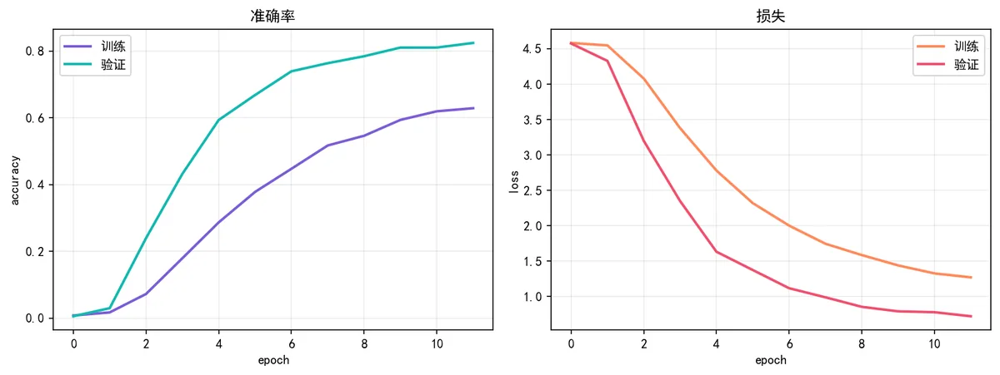
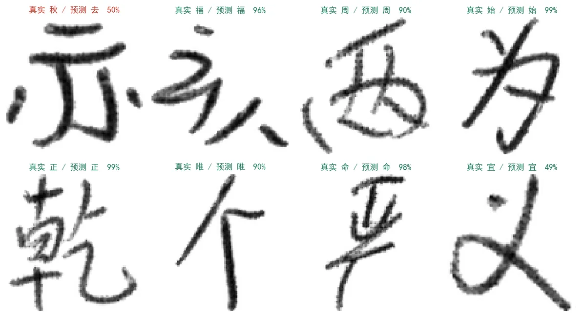

# hanzi-cnn

手写汉字 CNN 复现：97 类、5,193 张训练图、12 个 epoch，测试准确率 **82.8%**。

## 结果

| 指标 | 数值 |
| --- | --- |
| 类别数 | 97 |
| 训练 / 验证 / 测试 | 5,193 / 576 / 1,153 |
| 输入尺寸 | 96×96 灰度 |
| 验证准确率 | 82.5% |
| 测试准确率 | **82.8%** |
| 训练耗时 | 167 s（CPU） |





## 数据

数据目录结构：

```
data/
  train/<class_id>/*.png
  test/<class_id>/*.png
```

图片是变尺寸的手写裁剪，混有少量碎图。脚本会过滤最小边 < 16 的样本，并按长边补白成正方形再缩放，避免字形被拉伸。

数据集不随仓库提供；请按上面的结构放置自己的数据。

## 运行

```bash
pip install -r requirements.txt
python train.py --data ./data --out results
```

可用参数：`--size`、`--epochs`、`--per-class`、`--per-test`。

## 说明

- 结果是在「每类抽 60 张训练 / 12 张测试」的子集上得到的，全量复训会更高；
- 标签表 100 个字与训练目录 97 类的差异、碎图处理细节见博客文章；
- 下一步：分层采样、学习率衰减、混淆矩阵分析易混字。
